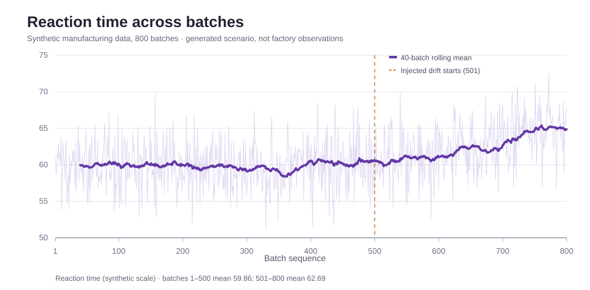
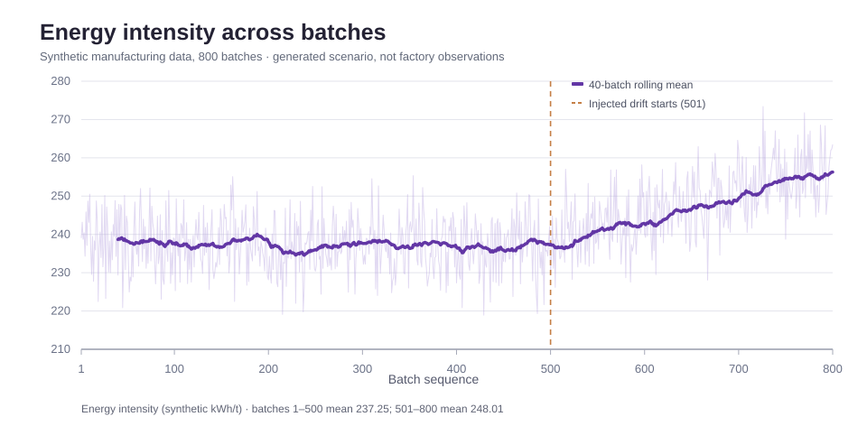
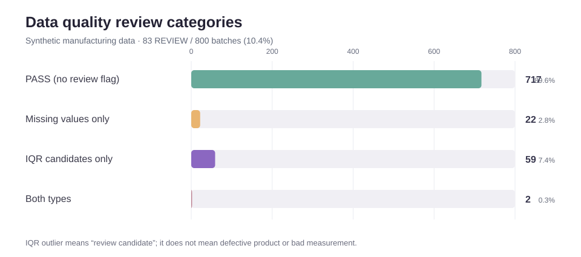

# 제조 Batch 데이터 기초 시각화

> 출처: 800개 Batch는 `generate_synthetic_data.py`에서 직접 만든 합성 데이터입니다. 실제 공장 측정값이나 개선 실적이 아닙니다.

## 1. 반응시간 추세



- Batch 1~500: 평균 59.86
- Batch 501~800: 평균 62.69
- 차이 +2.82 (합성 척도)

보라색 선은 40-Batch 이동평균입니다. Batch 500 이후 추세 변화는 생성 코드에서 의도적으로 설정했습니다.

## 2. 에너지 원단위 추세



- Batch 1~500: 평균 237.25
- Batch 501~800: 평균 248.01
- 차이 +10.76 (가상 kWh/t)

에너지 원단위는 생성 코드에서 온도·반응시간·설비 차이·시간 변화의 영향을 받도록 설계했습니다. 실측 공장 데이터가 아닙니다.

## 3. 데이터 품질 검토 현황



| 데이터 품질 분류 | Batch |
|---|---:|
| 결측/이상치 없는 PASS | 717 |
| 결측치만 포함 | 22 |
| IQR 이상치 후보만 포함 | 59 |
| 결측 및 이상치 모두 포함 | 2 |
| 전체 | 800 |

검토 대상(REVIEW)은 83개입니다. REVIEW는 품질 불량(NG)과 다른 지표입니다. IQR 이상치도 측정 오류 또는 실제 공정 특이현상일 수 있으므로 삭제하지 않고 표시했습니다.

추가로 NG 비율은 Batch 1~500의 16.4%(82/500)에서 Batch 501~800의 22.7%(68/300)로 달라집니다. 데이터 생성 규칙에 이미 위험확률 변화가 포함되어 있으므로 이 결과로 실제 인과관계나 공정개선 효과를 주장할 수 없습니다.

## 재생성 및 검증

시각화는 [통합 데이터](../01_data_integration/output/integrated_master.csv)를 입력으로 사용합니다. [시각화 코드](./render_charts.js)는 Node.js 표준 라이브러리만 사용하며 SVG 3개를 생성합니다.

```bash
node 07_manufacturing_extension/02_eda/render_charts.js
node 07_manufacturing_extension/02_eda/render_charts.js --check
```

`--check`는 현재 SVG 3개가 같은 코드와 데이터로 생성한 결과와 정확히 일치하는지 확인합니다. 자동 검증은 [GitHub Actions](https://github.com/dwk72/knou-data-analysis-manufacturing/actions/workflows/manufacturing_eda_figures.yml)에서 확인할 수 있습니다.

이 단계는 탐색적 시각화까지만 구현했습니다. 설비·원료·공정조건의 교차분석, 이상 원인 검증, 통계 모형화 및 현장 검증은 후속 작업입니다.
