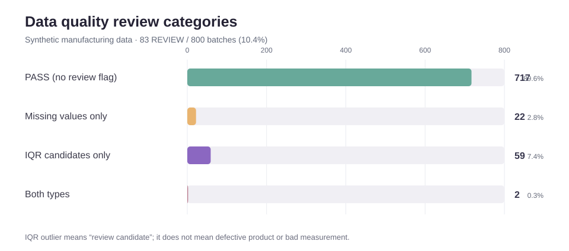
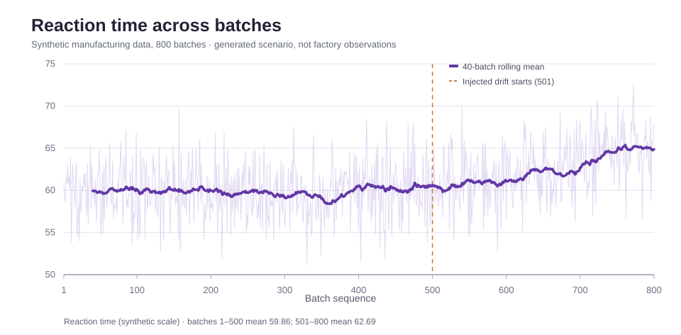
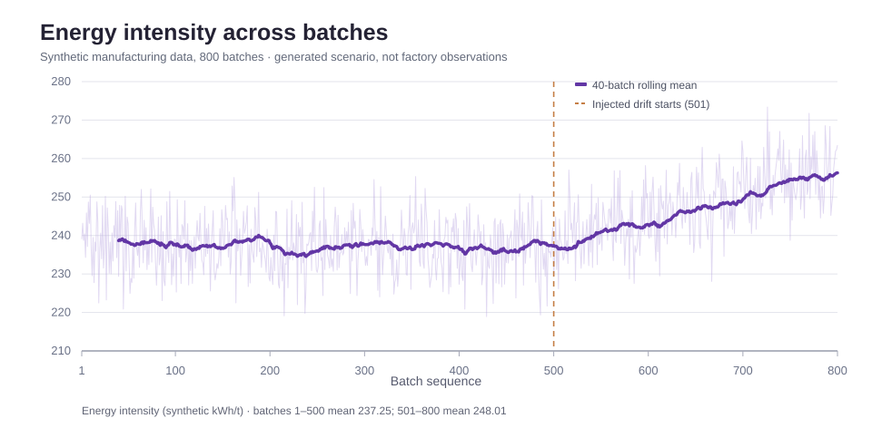

# 제조 Batch 데이터 통합·품질검증 자동화

Python · Pandas · Data Quality · Batch Manufacturing · Reproducibility

> 개인 포트폴리오 | 합성(Synthetic) 데이터 기반 | 데이터 통합·품질점검·기초 시각화 완료
>
> 이 저장소의 수치는 실제 화학공장이나 배터리 소재 생산라인에서 수집한 것이 아닙니다. 설정한 수식과 난수를 이용해 생성한 학습용 데이터이며, 실공정 개선 성과나 불량 원인 규명 결과로 제시하지 않습니다.

## 1. 프로젝트 개요

화학·배터리 소재의 Batch 제조에서 생산이력, 원료 LOT, 공정조건, 품질검사 결과가 서로 다른 테이블에 저장된 상황을 가정했습니다. 동일한 Batch의 기록을 정확히 연결하지 못하면 공정변수와 품질 간의 관계를 분석할 수 없습니다.

이 프로젝트는 복잡한 예측모델보다 그 이전 단계인 **데이터 연결의 신뢰성, 결측·이상값 확인, 재현 가능한 분석 입력 생성**에 초점을 맞췄습니다.

| 항목 | 구현 및 검증 결과 |
|---|---|
| 분석 단위 | Batch 800개, 원본 테이블 4개 |
| 데이터 구조 | 생산·원료·공정조건·품질 데이터, 원본 변수 총 19개 |
| 데이터 통합 | `batch_id` 기준 1:1 결합, 중복·연결 누락 검토 |
| 데이터 품질 | 결측 셀 25개(24 Batch), IQR 이상치 후보 61 Batch |
| 검토 대상 | REVIEW 83 Batch, PASS 717 Batch |
| 분석용 출력 | 전체 800 Batch 보존 + 결측 없는 776 Batch 별도 생성 |
| 시각화 | 반응시간 변화, 에너지 원단위 변화, 검토 대상 분류 |
| 재현성 검증 | GitHub Actions에서 생성·통합 결과 8개 CSV 비교, 테스트 4/4 통과 |

[통합·품질검증 코드와 상세 보고서](./01_data_integration/) · [시각화 코드 및 해석](./02_eda/) · [SQL 제조 KPI 분석](./03_sql_analysis/) · [자동 재현성 검증 결과](./01_data_integration/REPRODUCIBILITY_VALIDATION_2026-11-05.md)

## 2. 데이터 구조와 처리 과정

```text
[합성 데이터 생성: 800 Batch]
                │
      ┌─────────┼───────────┬──────────────┐
      ▼         ▼           ▼              ▼
  batch_master  material    process_condition  quality_result
      └─────────┴───────────┴──────────────┘
                │
       batch_id 기준 1:1 결합
                │
        중복·누락·타입 점검
                │
      결측 / IQR 이상치 표시
                │
       ┌────────┴─────────┐
       ▼                  ▼
  전체 통합본(800)    결측 없는 분석본(776)
       │
       └── 품질 요약 + 기초 EDA 시각화
```

- [데이터 생성 코드](./generate_synthetic_data.py): 원료 LOT 효과, 설비 차이, 시간에 따른 Drift, 품질판정 확률, 소량의 결측·극단값을 의도적으로 설정합니다. 난수 시드는 42입니다.
- [원본 데이터 4개](./data/): 원본은 모두 공개 가능한 합성 CSV입니다.
- [통합·검증 코드](./01_data_integration/integrate_and_validate.py): Pandas `merge(..., validate="one_to_one")`으로 Batch 단위 결합을 검증합니다.\n- [SQL 분석 코드](./03_sql_analysis/build_and_query.py): 같은 4개 테이블을 SQLite에 적재하고 JOIN·GROUP BY·CTE·Window Function으로 제조 KPI를 조회합니다.
- [통합 데이터·품질 보고서](./01_data_integration/output/): 결과 CSV 4개와 [품질검증 보고서](./01_data_integration/DATA_QUALITY_REPORT.md)를 공개합니다.

## 3. 데이터 품질 검증 결과



| 구분 | Batch 수 | 엔지니어링 해석 |
|---|---:|---|
| PASS | 717 | 적용한 결측·IQR 검토 기준 통과 |
| 결측만 존재 | 22 | 센서·시험 기록 등 누락 여부 확인 후보 |
| IQR 이상치 후보만 존재 | 59 | 측정 오류인지 실제 변동인지 추가 확인 필요 |
| 결측과 이상치 후보 모두 | 2 | 두 종류의 검토 필요 |
| 합계 | 800 | REVIEW 83 Batch |

IQR(사분위범위) 경계는 `Q1 - 1.5 × IQR`부터 `Q3 + 1.5 × IQR`까지입니다. 이 범위를 벗어나는 관측값을 자동 삭제하지 않고 **검토 플래그**로 남깁니다. 데이터 품질 REVIEW는 제품 품질 NG와 다릅니다.

개별 Batch에서 12개 핵심 수치형 변수의 결측값을 확인하고, 결측값이 없는 776개 Batch의 분석용 복사본을 별도로 만들었습니다. 전체 800개 Batch를 유지한 원본 통합본도 보존했습니다.

## 4. 기초 시각화: 의도적으로 삽입한 추세

합성 데이터 생성 코드에서 Batch 500 이후 반응시간과 에너지 원단위의 증가 경향을 삽입했습니다. 다음 그래프는 설정된 변화가 데이터에 어떻게 반영되는지 보여줍니다. 보라색 선은 직전 40 Batch의 이동평균입니다.

### 반응시간



- Batch 1~500 평균 59.86 → Batch 501~800 평균 62.69 (합성 척도)
- 차이 +2.82. 생성 규칙에 삽입한 Drift를 시각화한 것이며 실제 공장 이상징후를 탐지한 결과가 아닙니다.

### 에너지 원단위



- Batch 1~500 평균 237.25 → Batch 501~800 평균 248.01 (가상 kWh/t)
- 차이 +10.76. 실측 유틸리티 원단위나 실제 비용 절감 실적이 아닙니다.

그래프 작성 코드와 데이터 해석은 [02_eda](./02_eda/)를 확인할 수 있습니다.

## 5. 설계 과정에서 내린 판단

1. **데이터 통합 검증**: 1:1 관계를 명시해 중복 키로 인한 행 증폭을 방지했습니다.
2. **이상값 보존**: IQR 범위를 벗어났다는 이유만으로 관측값을 삭제하지 않았습니다. 제조 데이터에서는 극단값 자체가 점검 신호일 수 있기 때문입니다.
3. **분석 목적별 출력 분리**: 데이터 품질 문제가 기록된 전체 통합본과 결측값이 없는 분석용 데이터셋을 별도로 유지했습니다.
4. **재현 가능한 결과**: 난수 생성 규칙과 입력·출력 CSV를 저장하고, 별도의 깨끗한 실행환경에서 결과를 재생성·비교했습니다.

## 6. 실행 및 검증 방법

저장소 루트에서 실행합니다. Python 3.11 및 Pandas 2.2.3 기준으로 GitHub Actions 검증에 성공했습니다. Node.js 20은 SVG 그래프 생성에 사용했습니다.

```bash
python -m pip install "pandas==2.2.3"

# 합성 원본 데이터 생성
python 07_manufacturing_extension/generate_synthetic_data.py

# 4개 테이블 통합 및 결측·이상치 점검
python 07_manufacturing_extension/01_data_integration/integrate_and_validate.py

# 데이터 파이프라인 재현성 검증
python -m unittest discover -s tests -p "test_manufacturing_reproducibility.py" -v

# SVG 시각화 생성 및 파일 일치 검증 (Node.js 20)
node 07_manufacturing_extension/02_eda/render_charts.js
node 07_manufacturing_extension/02_eda/render_charts.js --check
```

자동화 및 증빙:
- [데이터 생성·통합 테스트 코드](../tests/test_manufacturing_reproducibility.py)
- [데이터 파이프라인 검증 로그: 4/4 통과](https://github.com/dwk72/knou-data-analysis-manufacturing/actions/runs/41981724270)
- [시각화 생성 및 재검증: 성공](https://github.com/dwk72/knou-data-analysis-manufacturing/actions/runs/42061282044)
- [검증 절차·수치·제약 기록](./01_data_integration/REPRODUCIBILITY_VALIDATION_2026-11-05.md)

## 7. 구현 범위와 한계

| 구현·검증된 항목 | 아직 구현·검증하지 않은 항목 |
|---|---|
| 합성 Batch 데이터 생성 | 실제 설비·제품 데이터에 대한 적용 |
| 생산·원료·공정·품질 테이블 연결 | 원인 규명 및 실공정 실험 검증 |
| 결측·IQR 이상값 검토 | 설비·원료 LOT별 심화 교차분석 |
| 데이터 보존·분리와 요약 보고 | PCA / 품질예측 |
| 공정변수 추세·데이터 품질 시각화 | 실제 개선 전후 성과와 경제성 평가 |
| SQL JOIN·집계·CTE·Window Function 제조 KPI 조회 | 타 제조공정으로의 일반화 성능 평가 |\n| 동일 결과 재생성 및 CI 자동 검증 | 실제 DBMS 운영환경·권한·성능 검증 |

수치형 변수 간 인과관계와 OK/NG 위험구조는 생성 코드에서 정의한 것입니다. 따라서 이후 데이터에서 해당 관계를 확인해도 실제 공정의 원인을 새로 밝혀냈다는 뜻은 아닙니다. 이 사례는 **제조 데이터의 구조화·품질검증·재현성 확보** 역량을 보여주는 범위로 소개합니다.

---

학업 기반 분석 과제와 다른 복원 코드는 [저장소 첫 화면](../) 및 [복원 기록](../RESTORATION_STATUS.md)을 참고해 주세요.
