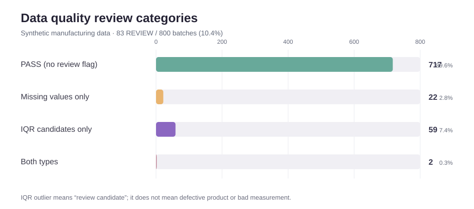

# KNOU 데이터 분석 × 제조 데이터 엔지니어링

## 대표 프로젝트: 제조 Batch 데이터 통합·품질검증 자동화

[프로젝트 상세 보기](./07_manufacturing_extension/) · [분석 코드 및 데이터](./07_manufacturing_extension/01_data_integration/) · [기초 시각화 3종](./07_manufacturing_extension/02_eda/) · [GitHub Actions 검증 결과](https://github.com/dwk72/knou-data-analysis-manufacturing/actions/runs/41981724270)

화학·배터리 소재 Batch 제조를 가정해, 나뉘어 저장된 생산·원료·공정조건·품질 정보를 연결하고 데이터 품질을 점검하는 파이프라인을 구현했습니다. 실제 회사의 데이터가 아닌 합성 제조 데이터 800 Batch를 사용한 개인 프로젝트입니다.

| 구현 내용 | 확인된 결과 |
|---|---|
| Batch 통합 | 4개 테이블, 원본 변수 19개, 통합 후 800행 |
| 품질 검토 | 결측 셀 25개, IQR 이상치 후보 61 Batch, REVIEW 83 Batch |
| 출력 데이터 | 전체 보존 800 Batch + 결측 없는 776 Batch |
| 시각화 | 반응시간, 에너지 원단위, 데이터 품질 검토 분포 |
| 재현성 | 독립 환경 자동 테스트 4/4 통과, 8개 CSV 재생성·비교 |



> 데이터 생성 규칙에 설비 효과와 시간 경과에 따른 변화가 의도적으로 포함되어 있습니다. 이 결과는 실공정 문제의 원인 규명이나 생산성 개선 성과가 아닙니다.

---

## 학업 기반 코드 및 학습 내용

> 기존 제출 과제에서 확인된 분석 내용과 공개용 재구성 코드는 [복원·검증 상태](./RESTORATION_STATUS.md)에 구분해 기록했습니다.


방송통신대학교 통계·데이터과학 및 컴퓨터과학 과제에서 수행한 분석을 비식별화해 정리하고, 별도의 합성 제조 데이터 사례에 적용한 저장소입니다.

핵심 목적은 두 가지입니다.

1. Python, R, 머신러닝, 데이터베이스를 실제 과제에서 어떻게 사용했는지 기록
2. 배운 분석기법을 배터리·화학 **생산기술(Manufacturing / Process Engineering)** 문제에 어떻게 연결할 수 있는지 단계적으로 확장하기

> **현재 범위**
> - 제출 과제에서 확인한 분석 내용과 이를 근거로 재구성한 코드는 구분해 기록
> - 개인정보가 포함된 원본 PDF/DOCX는 공개하지 않음
> - 제조 합성 데이터 생성·통합·품질점검·기초 시각화는 구현 완료. 제조 심화 EDA와 품질모델링은 향후 단계
> - 제조 확장은 합성 데이터 기반의 데이터 통합·품질검증·기초 시각화까지 구현했으며, 실제 현장 적용 실적은 없음

## 한눈에 보기

| Section | 무엇을 했는가 | 사용 도구 | 제조업에서의 확장 방향 |
|---|---|---|---|
| [01. Python Data Pipeline](./01_python_data_pipeline/) | 공공 API에서 데이터를 받아 정리·통합 | Python, requests, pandas, JSON | LOT/Batch·설비·품질 데이터 통합 |
| [02. Multivariate Analysis](./02_multivariate_analysis/) | 여러 변수의 관계를 한 번에 분석 | R, Python, PCA, 인자분석 | 공정변수 상관관계·이상 LOT 탐색 |
| [03. Time-Series Analysis](./03_time_series_analysis/) | 시간에 따라 변하는 데이터의 패턴 분석 | R, 시계열 분석 | 공정 Drift·주기성·이상징후 탐색 |
| [04. Quality Modeling](./04_quality_modeling/) | 품질 결과를 설명·분류하는 모델 비교 | R, 회귀, 로지스틱 회귀, CART | 품질 영향인자 탐색·OK/NG 분류 |
| [05. ML/DL Foundations](./05_ml_dl_foundations/) | 신경망 구조와 학습조건 변경 실험 | PyTorch, TensorFlow | 품질예측·비전·이상감지로 확장 |
| [06. Database Foundations](./06_database_foundations/) | 데이터베이스 구조 설계의 기초 학습 | DBMS, ERD | Batch/LOT–Process–Quality 데이터 구조 설계 |
| [07. Manufacturing Extension](./07_manufacturing_extension/) | 합성 Batch 데이터 생성·통합·품질점검·기초 시각화 | Python, Pandas, Node.js | 통합 데이터의 신뢰성 검증·재현 가능한 시각화 |

## 현재까지 확인 가능한 역량

### Python
공공 API에서 데이터를 받아 파일로 저장하고, 분석에 필요한 형태로 정리하는 일련의 과정을 수행했습니다.

- `requests`를 이용한 공공 API 호출
- JSON 데이터 저장 및 읽기
- `pandas.DataFrame`으로 표 형태 변환
- 날짜·숫자 형식 정리
- 결측치 처리
- 여러 기간의 데이터 통합
- CSV 저장 및 기초 시각화

### R / 통계분석
데이터의 관계를 설명하고, 여러 변수와 시간 흐름을 해석하는 분석을 수행했습니다.

- 단순·다중회귀
- 로지스틱 회귀
- 변수선택
- 주성분분석(PCA) 및 인자분석
- 시계열의 주기성·추세 분석
- 로그변환·차분
- 정상성 검정(ADF)
- 자기상관 분석(ACF / PACF)

### Machine Learning
단순히 모델을 실행하는 데 그치지 않고, 구조와 학습조건을 바꿨을 때 결과가 어떻게 달라지는지 비교했습니다.

- PyTorch 기반 MNIST 모델 구조 변경
- ReLU 활성화함수 추가
- Optimizer를 SGD에서 Adam으로 변경
- Learning rate 비교
- 모델 구조와 학습조건 변경 후 성능 비교

### Database
데이터를 파일로 흩어 저장할 때 생기는 문제와, 이를 데이터베이스 구조로 관리하는 기본 개념을 학습했습니다.

- 데이터 종속·중복·무결성·동시접근 문제
- 온라인 서점 요구사항 기반 ER 모델링
- 관계형 데이터 모델링 기초

## 제조업과 연결하는 방식

이 저장소는 분석기법을 나열하는 데서 끝내지 않고, 이후 아래 흐름으로 제조 문제에 연결하는 것을 목표로 합니다.

```text
데이터 수집
   ↓
데이터 정리·통합
   ↓
공정 상태 파악(EDA / 다변량 분석)
   ↓
시간 변화 모니터링
   ↓
품질·공정 모델링
   ↓
엔지니어링 관점의 해석
```

제조 사례는 배터리 또는 화학공정의 **합성(Synthetic) 데이터**를 사용합니다. 실제 근무지의 원본 데이터나 기밀자료는 사용하지 않았습니다.

## 진행 상태

- [x] Python API / ETL 학업 기반
- [x] R/Python 다변량분석 학업 기반
- [x] R 시계열분석 학업 기반
- [x] R 품질모델링 학업 기반
- [x] ML/DL 학습 및 모델 변경 실험
- [x] DBMS / ER 모델링 기초
- [x] 제조 확장 Case / 데이터 구조 설계
- [x] 제조용 합성 데이터셋
- [x] 제조 데이터 통합 / 품질점검
- [x] 기초 EDA 시각화 3종 및 SVG 재현성 검사
- [ ] 제조 EDA 확장
- [ ] 공정 시계열 확장
- [ ] 제조 품질예측
- [ ] 제조 데이터베이스 SQL 실습

상세 계획은 [ROADMAP.md](./ROADMAP.md)에 정리했습니다.

## 자료 공개 원칙

원본 과제에는 이름·학번·연락처 등 개인정보가 포함되어 있어 공개 저장소에는 올리지 않습니다. 이 저장소에는 실제 수행한 분석 흐름과 코드를 개인정보·인증키·개인 PC 경로를 제거한 형태로 재정리합니다.

---

**관련 직무:** Manufacturing Engineering · Process Engineering · Production Technology · Battery / Chemical Manufacturing · Manufacturing Data Analytics
