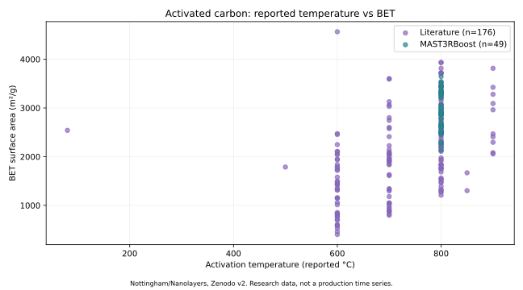
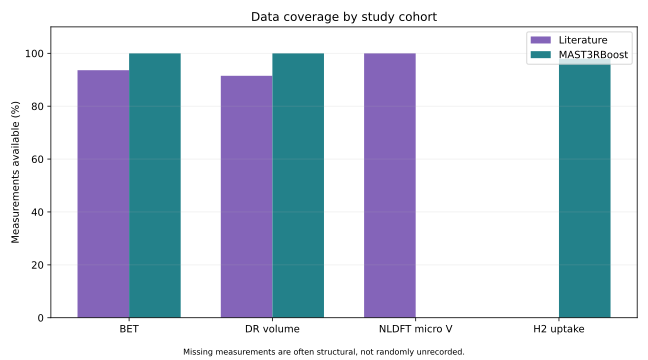

# 제조 데이터 포트폴리오 | 탄소소재 · 화학 Batch

화학공정·제조 데이터를 Python으로 정리하고, 공정조건과 제품 물성의 관계를 검토하기 위한 개인 포트폴리오입니다.

기존 학업·합성 Batch 프로젝트는 삭제하지 않고 아래의 **기존 프로젝트(보존)** 섹션으로 분리했습니다.

## 대표 프로젝트: 탄소소재 제조조건·물성 분석

[탄소소재 프로젝트 전체 보기](./carbon_materials_process_quality/) · [출처별 공정조건·원료 조성 분석](./carbon_materials_process_quality/02_process_relationships/) · [실제 공개 데이터 출처](https://zenodo.org/records/23311682) · [재현성 검증](https://github.com/dwk72/knou-data-analysis-manufacturing/actions/workflows/carbon_process_relationships.yml)

University of Nottingham과 Nanolayers의 공개 활성탄 데이터를 사용해 원료 조성, 활성화 온도·유지시간, BET 비표면적 등의 관계를 탐색합니다. 실제 회사에서 생산한 데이터가 아닌 연구·문헌 시료 자료이며, 양산 공정의 인과관계나 개선 실적을 주장하지 않습니다.

| 검증한 항목 | 결과 |
|---|---|
| 분석 대상 | 실제 공개 연구자료 237개 활성탄 시료 |
| 자료 구분 | 문헌 시료 188개 / 연구 프로젝트 시료 49개 |
| 원본 데이터 | 34개 변수, 시료 ID 중복 0건 |
| BET 측정 | 225개 측정, 12개 미측정 |
| 분석 내용 | 출처별 측정 커버리지, 온도·원료 조성과 BET 관계 탐색, 회귀·부트스트랩·교차검증 |
| 재현성 | 원본 MD5 검증, 시료·모형 검증 테스트 및 GitHub Actions 실행 통과 |
| 공개 범위 | 분석 스크립트·집계 통계·그래프. 원본 CSV는 비배포 |

자료 원본의 이용조건은 CC BY-ND 2.5입니다. 코드가 실행될 때 공식 출처에서 원본 파일을 내려받고, 저장소에는 원본 파일 및 수정된 행 단위 데이터를 올리지 않습니다.

## 제조조건 분석의 주요 판단

- 문헌 시료 162개(온도 600·700·800°C)에서 온도와 원료 성분을 함께 고려한 탐색 회귀를 수행했습니다.
- Nottingham 연구 시료 49개는 모두 800°C이므로, 이 집단에서는 활성화 온도의 영향을 추정할 수 없습니다.
- K/C와 O/C가 강하게 상관돼 있고 단순 상관과 다중회귀 계수의 부호도 달라집니다. 따라서 데이터의 차이를 제조조건의 인과효과로 단정하지 않았습니다.

[상세 분석 및 검증 한계 읽기](./carbon_materials_process_quality/02_process_relationships/)

## 기존 프로젝트 (보존)

### 화학·배터리 합성 Batch 데이터 통합·품질검증

[기존 제조 Batch 프로젝트](./07_manufacturing_extension/) · [데이터 통합 및 점검](./07_manufacturing_extension/01_data_integration/) · [기초 EDA 시각화](./07_manufacturing_extension/02_eda/)

- 합성 Batch 데이터 800개를 직접 생성하고 원료·공정·생산·품질 정보 4개 테이블로 나누었습니다.
- Batch ID 기준으로 자료를 연결해 결측·IQR 이상치 후보를 검토했습니다.
- REVIEW 83개 Batch를 구분하고 원본 800개와 결측 없는 776개 분석용 데이터셋을 보존했습니다.
- Python 자동 재현성 검사 4개 테스트를 통과했습니다.
- 실측 공장 데이터와 실제 개선 실적은 아닙니다.

기존 프로젝트의 경로와 내용은 유지했습니다. 이전 GitHub 첫 화면 내용도 [LEGACY_README.md](./LEGACY_README.md)에 별도로 보존했습니다.

## 방송통신대학교 통계·컴퓨터과학 학업 기반

| 영역 | 관련 코드 및 정리 |
|---|---|
| Python 데이터 수집·처리 | [01_python_data_pipeline](./01_python_data_pipeline/) |
| PCA·인자분석 | [02_multivariate_analysis](./02_multivariate_analysis/) |
| 시계열 분석 | [03_time_series_analysis](./03_time_series_analysis/) |
| 회귀·품질모델링 | [04_quality_modeling](./04_quality_modeling/) |
| 머신러닝·딥러닝 실습 | [05_ml_dl_foundations](./05_ml_dl_foundations/) |
| 데이터베이스 기초 | [06_database_foundations](./06_database_foundations/) |

학업 과제를 공개용으로 재구성한 코드에는 원본 데이터가 누락된 사례가 있습니다. [복원·검증 범위](./RESTORATION_STATUS.md)에서 수행 여부와 재현 한계를 구분해 확인할 수 있습니다.

## 포트폴리오 원칙

- 실제 공개 연구데이터, 학습용 합성 데이터, 실무경험을 구분해 표기합니다.
- 원료·공정조건과 품질변수 사이의 상관관계를 원인효과로 단정하지 않습니다.
- 측정 누락과 자료 출처·시료 단위를 확인한 뒤 분석합니다.
- 개인식별정보·회사 기밀자료·API 인증정보를 공개하지 않습니다.
- 구현과 검증이 완료되지 않은 기능은 성과로 소개하지 않습니다.

관련 직무: 탄소소재 / 전자소재 / 화학공정 / 생산기술 / 제조 데이터 분석.
