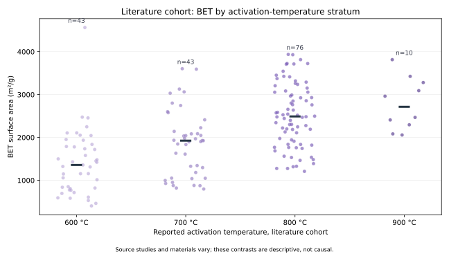
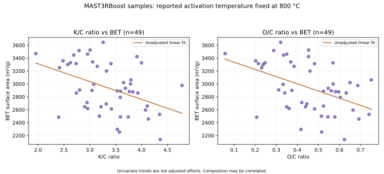

# 02. 활성탄 제조조건–BET 비표면적 관계 분석

> 공개 연구자료 기반 탐색 분석 | 출처 집단 분리 | 원인효과·최적조건·양산 검증 주장 없음

## 생산기술 엔지니어라면 무엇을 먼저 판단해야 하는가?

활성탄 제조에서 원료 물성이나 활성화 조건에 따라 BET 비표면적이 달라지는지 확인하고 싶어도, 실험 자료를 무조건 합쳐 회귀모델을 만들면 잘못된 결론에 도달할 수 있습니다.

이 데이터는 동일 공정의 시간순 생산 실적이 아닙니다. 연구문헌에서 수집한 188개 시료와 MAST3RBoost 연구의 49개 시료로 구성되어 있고, 두 집단의 제조조건과 측정 항목이 다릅니다.

따라서 먼저 다음을 확인했습니다.

1. 활성화 온도가 시료별로 실제로 달라지는가?
2. 원료 조성(K/C, O/C, N/C)을 같은 조건에서 비교할 수 있는가?
3. 단순 상관과 여러 변수를 함께 고려한 통계모형의 결론이 일치하는가?
4. 이 데이터로 말할 수 있는 것과 추가 확인실험이 필요한 것은 무엇인가?

## 첫 화면에서 확인할 결과

| 제조 질문 | 관찰된 데이터 | 해석 가능 범위 |
|---|---|---|
| 온도와 BET 관계 | 문헌에서 600°C 43개, 700°C 43개, 800°C 76개 BET 관측 | 온도별 시료군의 탐색적 비교 가능. 동일 원료·동일 실험조건의 인과효과 아님 |
| Nottingham 연구의 온도 효과 | 연구 시료 49개가 모두 800°C | 집단 내부에서 온도 효과 추정 불가 |
| 원료 조성과 BET | 800°C 고정 시료에서 K/C·O/C·N/C 값이 달라짐 | 조성의 단순·조건부 연관성 분석 가능 |
| 모델 결론의 안정성 | O/C는 단순 상관과 조건부 회귀계수의 부호가 다름 | 단일 변수의 영향으로 단정하면 안 됨 |
| 현장 적용 | 원료 LOT·열처리 이력·수율·시험방법 정보 부족 | 실제 Pilot/양산 조건의 최적화나 개선 성과 주장 불가 |

## 1. 문헌 시료의 활성화 온도



| 활성화 온도 | BET 측정 시료 | 평균 BET (m²/g) |
|---|---:|---:|
| 600°C | 43 | 1,409.54 |
| 700°C | 43 | 1,862.13 |
| 800°C | 76 | 2,512.89 |
| 900°C | 10 | 2,788.16 |

문헌 시료에서는 온도가 높은 집단일수록 BET 평균도 높은 경향이 관찰됩니다. 하지만 연구 원료와 제조 방법의 차이를 통제하지 않았기 때문에 온도 상승에 의한 증가로 해석할 수 없습니다.

다중회귀를 시도할 때는 충분한 자료가 있는 600·700·800°C의 162개 관측치를 우선 사용했습니다. 500°C는 1개, 850°C는 2개, 900°C는 10개이며, 원본 80°C 기록 1개는 자료 검증 대상으로 남겼습니다. 원본의 80°C 기록을 800°C로 임의 수정하지 않았습니다.

사전 지정한 다중회귀 변수는 온도, K/C, O/C, N/C, Porogen입니다. 162개 시료에 대한 조건부 온도 연관계수는 100°C당 약 +477 m²/g으로 계산됐습니다. 쌍별 부트스트랩의 95% 구간은 약 +357~+587 m²/g입니다. 이는 사용한 관측 자료와 선택한 모형 안의 통계적 연관성일 뿐, 온도를 올렸을 때 실제 생산품이 그만큼 개선된다는 의미는 아닙니다.

600~900°C의 174개 시료로 범위를 넓힌 민감도 모델에서 온도 100°C당 조건부 연관계수는 약 +445 m²/g으로 계산됐습니다. 기본 모형의 약 +477과 방향은 같지만, 두 결과 모두 인과효과는 아닙니다.

모형의 반복 5-fold 교차검증 R² 중앙값은 약 0.626, MAE는 약 399 m²/g이었습니다. 연구별 그룹화 검증을 하지 못했고 부트스트랩도 시료 간 독립성을 가정합니다. 따라서 독립적인 다른 연구나 공장에 대한 예측 성능이라고 말할 수 없습니다.

## 2. Nottingham 연구 시료: 800°C에서 조성 비교



MAST3RBoost 연구 시료 49개에서 보고된 활성화 온도는 모두 800°C입니다. K/C와 O/C는 시료마다 달라집니다.

| 조성 변수 | BET와의 단순 Pearson 상관 |
|---|---:|
| K/C | -0.426 |
| O/C | -0.462 |
| N/C | +0.546 |

K/C, O/C, N/C를 함께 넣은 다중회귀에서는 O/C 계수의 부호가 양(+)으로 바뀌었습니다. 즉, 단순 상관과 조건부 분석의 방향이 서로 다릅니다.

실제로 K/C와 O/C의 상관계수는 약 +0.918로 매우 높습니다. 두 변수가 강하게 연관된 상태에서는 다중회귀의 개별 계수 방향이 불안정할 수 있습니다.

이는 조성변수가 함께 변하거나 일부 조건이 통제되지 않은 자료에서 단일 상관계수에 의존하면 위험하다는 것을 보여줍니다. 실제 제조조건을 변경할 근거가 되지 않습니다.

반복 5-fold 교차검증 R² 중앙값은 약 0.378이며 MAE는 약 232 m²/g입니다. 프로젝트 시료 내부의 탐색적 수치이며 외부 제조 데이터에 대한 검증은 아닙니다.

## 3. 재현성과 분석 코드

- [Python 분석 코드](./analyze_relationships.py)
- [상세 분석 보고서](./results/REPORT.md)
- [집계·모형 결과 JSON](./results/summary.json)
- [데이터 계약·기초 EDA](../)
- [검증 테스트](../../tests/test_carbon_process_relationships.py)
- [자동 실행 워크플로](../../.github/workflows/carbon_process_relationships.yml)

저장소 루트에서 실행합니다.

```bash
python -m pip install -r carbon_materials_process_quality/requirements.txt
python carbon_materials_process_quality/02_process_relationships/analyze_relationships.py
python -m unittest discover -s tests -p "test_carbon_process_relationships.py" -v
```

원본은 University of Nottingham·Nanolayers의 [Zenodo v2 데이터](https://zenodo.org/records/23311682)이며, 무결성을 확인한 뒤 메모리에서 처리합니다. 원본 CSV와 행 단위 수정본은 GitHub에 올리지 않습니다.

## 4. 현장 적용 시 필요한 확인

실제 탄소소재 Scale-up에 활용하려면 원료 제조·특성 이력, 활성화제 투입량, furnace 온도 프로파일, 분위기·유량, 유지시간, 설비 규모, 제조 수율, BET 시험법·반복 측정, 에너지 원단위가 필요합니다.

현 단계의 분석은 공정 변경을 권고하지 않습니다. 동일 원료와 동일 분석법을 유지한 독립 확인실험이 확보돼야 조건 변경의 타당성을 검증할 수 있습니다.
