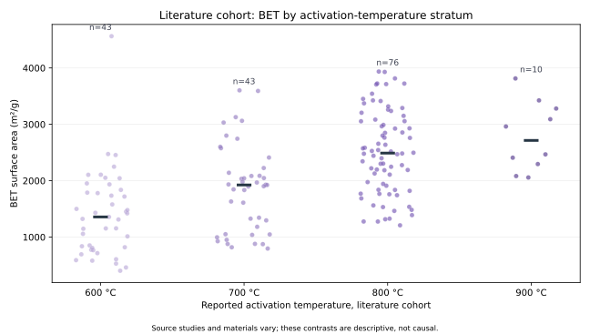
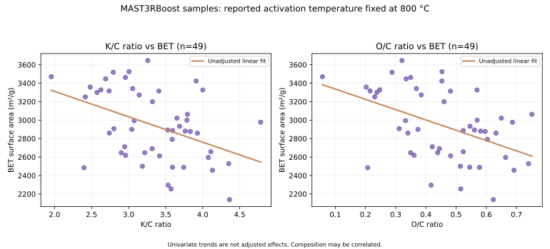

# 탄소소재 제조조건과 BET: 출처 분리 탐색 분석

> 관찰된 연구자료의 통계적 연관성만 분석합니다. 인과효과, 양산 최적 조건, 연구 간 일반화 성능은 검증되지 않았습니다.

## 출처·관측단위

- University of Nottingham / Nanolayers, Zenodo v2, DOI 10.5281/zenodo.23311682.
- 단위: 활성탄 시료. 양산 Batch의 시계열이 아닙니다.
- 문헌 BET 관측 176개, 프로젝트 시료 49개.
- 원본 CSV는 직접 내려받아 처리하고, 수정된 행 단위 사본을 공개하지 않습니다.

## 1. 문헌 시료: 활성화 온도와 BET

| 보고 온도(°C) | 시료 수 | BET 측정 수 | 평균 BET(m²/g) | 중앙값 BET(m²/g) |
|---:|---:|---:|---:|---:|
| 80 | 1 | 1 | 2540.29 | 2540.29 |
| 500 | 1 | 1 | 1786.72 | 1786.72 |
| 600 | 46 | 43 | 1409.54 | 1356.77 |
| 700 | 46 | 43 | 1862.13 | 1924.24 |
| 800 | 82 | 76 | 2512.89 | 2489.87 |
| 850 | 2 | 2 | 1485.36 | 1485.36 |
| 900 | 10 | 10 | 2788.16 | 2714.72 |

- 80 °C는 특이 기록이며 원자료를 임의로 800 °C로 고치지 않았습니다.
- 500 °C 1개, 850 °C 2개 시료는 표본 지원이 적어 1차 모델에서 제외했습니다.
- 900 °C도 10개 관측뿐이어서 기본 비교는 600·700·800 °C의 충분한 표본이 있는 집단에 제한했습니다.
- 전체 문헌 시료에서 온도와 BET의 단순 Pearson r = +0.443. 다른 제조·원료 요인을 제거한 수치가 아닙니다.
- 1차 다중회귀 입력: 문헌 시료 162개, 활성화 온도(100 °C 단위), K/C, O/C, N/C, Porogen. 다음 계수는 이 표본 안에서의 조건부 연관성입니다.

| Predictor | Fitted association (m²/g per unit) | Bootstrap 95% interval |
|---|---:|---:|
| Temperature (+100 °C) | +476.74 | [+357.47, +586.81] |
| K/C ratio (+1) | +277.32 | [+171.93, +393.85] |
| O/C ratio (+1) | -912.47 | [-1420.71, -479.57] |
| N/C ratio (+1) | +3366.42 | [+2626.32, +4087.91] |
| Porogen (1 vs 0) | +812.47 | [+640.09, +965.53] |

- 단순 OLS 설명력(훈련 표본 R²): 0.649. 반복 5-fold CV 중앙 R²: 0.626.
- CV MAE: 모델 398.71 m²/g, 훈련집단 평균 기준모델 721.93 m²/g.
- 연구별 반복·동일 원료·측정법 구분키가 없으므로 교차검증에서도 연구 간 일반화 성능을 주장할 수 없습니다.

## 2. MAST3RBoost 시료: 800 °C 고정 조건의 조성 비교

- 시료 49개는 모두 활성화 온도가 800 °C이고 유지시간 등도 일정합니다.
- 따라서 이 집단만으로는 활성화 온도 변화의 효과를 평가할 수 없습니다.
- K/C–BET 단순 Pearson r = -0.426. O/C–BET r = -0.462. N/C–BET r = +0.546.

- K/C, O/C, N/C를 사전 지정한 공변량으로 다중회귀를 구성했습니다. 조성 간 동시 변동 때문에 단일 변수의 인과적 기여를 의미하지 않습니다.

| Predictor | Fitted association (m²/g per unit) | Bootstrap 95% interval |
|---|---:|---:|
| K/C ratio (+1) | -850.37 | [-1320.91, -350.11] |
| O/C ratio (+1) | +2776.95 | [+570.22, +4721.14] |
| N/C ratio (+1) | +3366.30 | [+1798.80, +4586.61] |

- 단순 OLS 설명력(훈련 표본 R²): 0.487. 반복 5-fold CV 중앙 R²: 0.378.
- CV MAE: 모델 231.57 m²/g, 훈련집단 평균 기준모델 325.83 m²/g.

## 엔지니어의 판단

1. 활성화 온도는 출처마다 다르게 설계됐습니다. 800 °C 고정 연구 시료에서는 온도 비교가 불가능합니다.
2. 문헌의 원료 종류·제조 조건·BET 측정법이 혼재되어 온도-물성 관계를 공정 인과효과로 해석할 수 없습니다.
3. 단순 상관과 다중회귀 계수, bootstrap 구간, CV 오차를 구분했습니다. 계수가 0에서 멀더라도 실험적 확인이 필요합니다.
4. 시료 간 교차검증은 동일 연구 내 유사 조건이 다른 폴드에 들어갈 수 있어, 외부 연구·공장으로의 이전 성능을 입증하지 못합니다.
5. Pilot/양산 적용 전에는 원료 LOT, furnace temperature profile, 가열 분위기, 장치 Scale, 체류시간, 제품 수율, BET 시험법, 에너지 원단위 및 독립 확인실험 자료가 필요합니다.

## 구현 및 제한

- 이번 작업은 공개 연구자료의 출처별 기초 비교·조건부 회귀·부트스트랩·샘플 기준 CV까지 구현했습니다.
- 통계모형의 사용은 탐색적 평가 목적이며 공정조건 최적화나 생산효율 개선의 증거가 아닙니다.
- 원래 문헌 시료에서 동종 실험 조건을 식별하는 연구별 ID가 제공되지 않아 study-blocked 검증을 수행하지 않았습니다.
- CI 테스트는 원본 데이터 무결성·샘플 구조·결과 산출의 코드 재현성을 검증합니다.
