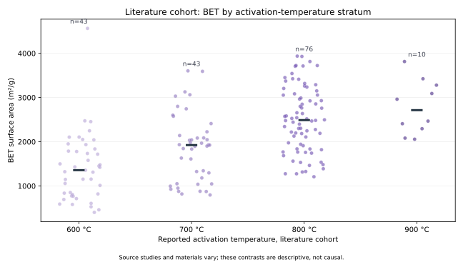
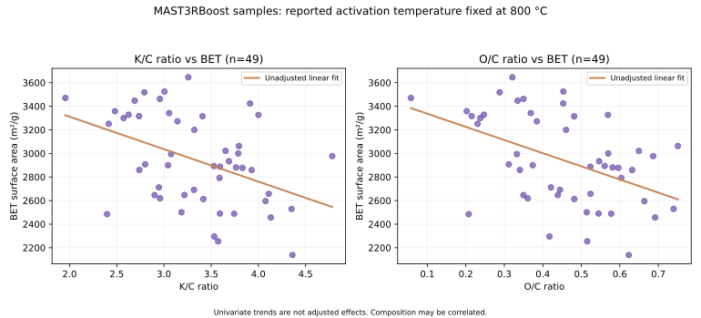

# 탄소소재 제조조건·물성 데이터 분석

Python · Pandas · Matplotlib · 원료 조성 · 활성화 조건 · BET 비표면적

> 공개 연구데이터 기반의 독립 제조 데이터 분석 프로젝트입니다. 실측 양산 Batch 데이터나 본인 회사의 제조 실적은 사용하지 않았습니다. 기존 합성 Batch 프로젝트는 [별도 경로](../07_manufacturing_extension/)에 그대로 보존했습니다.

## 1. 제조 질문

원료의 원소 조성, 활성화 온도·유지시간, K/C 비율 등 여러 실험조건과 활성탄의 기공·BET 물성은 어떤 관계를 보이는가?

실제 공정 엔지니어가 자료를 분석한다면 다음을 먼저 확인해야 합니다.

1. 서로 다른 연구에서 생산한 시료를 같은 집단으로 취급해도 되는가?
2. BET·기공부피·수소 흡착량은 모든 시료에서 동일하게 측정됐는가?
3. 온도와 BET가 함께 변하더라도 원료 조성과 활성화제 비율, 측정방법 차이를 어떻게 분리할 것인가?
4. Lab 연구 결과를 Pilot·양산의 운전조건과 품질관리로 확장하려면 무엇이 더 필요한가?

## 2. 실제 데이터 출처

- 기관: University of Nottingham (producer), Nanolayers (data manager)
- 명칭: Activated Carbon Materials for Hydrogen Storage - University of Nottingham
- 원본: [Zenodo 공식 데이터 v2](https://zenodo.org/records/23311682)
- DOI: [10.5281/zenodo.23311682](https://doi.org/10.5281/zenodo.23311682)
- 원본 파일: mast3rboost-AC-UON.csv
- 소스 원본 MD5: 0e38bd5c6a66dc8ff62f5831a90b55b0
- 이용조건: CC BY-ND 2.5. **원본 파일 및 수정된 행 단위 자료를 저장소에 재배포하지 않습니다.** 공식 URL에서 실행 시 내려받습니다.

공식 기록상 총 237개 활성탄 시료입니다. 처음 188개는 기존 문헌 수집, 마지막 49개는 MAST3RBoost 프로젝트 연구자료입니다. 이는 서로 다른 양산 Batch의 시계열이 아닙니다.

| 구분 | 원료·공정조건 예시 | 결과 물성 예시 |
|---|---|---|
| 원료 조성 | O/C, H/C, N/C, K/C, K/O, Porogen | BET 비표면적 |
| 활성화 공정 | Activation temperature, dwell time, ramp rate | DR 기공부피, NLDFT 기공특성 |
| 제품 성능 | 측정방법·출처별 차이 검토 필요 | 수소 저장량(일부 시료만 측정) |

실제 CSV는 세미콜론 구분, 별도 단위 행, 말단 여분 구분자, [ouptut] ABET 원문 오타를 포함합니다. 데이터 정리 코드에서 이를 명시적으로 처리합니다.

## 3. 완료한 분석 범위

[분석 스크립트](./analyze.py)는 원본 CSV의 MD5를 검증한 후 다음 순서로 처리합니다.

- 관측 단위(시료 ID), 스키마, 행 수 및 중복 여부 확인
- 연구 출처 집단 구분 및 측정값의 결측 패턴 점검
- BET 비표면적의 출처별 기초 통계 계산
- 활성화 온도와 BET 사이의 탐색적 산점도
- 주요 결과변수의 출처별 측정 커버리지 비교
- 집계 수준의 분석 보고서·JSON·SVG 그래프 출력

| 기초 검증 지표 | 확인된 값 |
|---|---:|
| 전체 시료 | 237개 |
| 원본 변수 | 34개 |
| 문헌 시료 | 188개 |
| 연구 프로젝트 시료 | 49개 |
| BET 관측값 | 225개 |
| BET 결측값 | 12개 |
| 문헌 시료의 수소 흡착량 측정 | 0개 |
| 연구 프로젝트 시료의 수소 흡착량 측정 | 48개 |

수소 흡착량의 결측은 해당 실험이 수행되지 않은 경우가 대부분입니다. 이를 0으로 대체하지 않습니다.

## 4. 분석 결과·그래프

실제 실행 검증을 통해 생성된 집계 결과는 아래에 공개합니다. 그래프는 연구 시료의 관측 관계를 표현하며 인과관계·최적 운전조건을 입증하지 않습니다.

- [분석 결과 보고서](./results/REPORT.md)
- [온도 × BET 산점도](./results/figures/temperature_vs_bet.svg)
- [출처별 측정 커버리지](./results/figures/coverage_by_cohort.svg)
- [집계 통계 JSON](./results/summary.json)

## 5. 출처별 제조조건·원료 조성 관계 분석

[제조조건과 BET 비표면적의 관계 분석 상세 보기](./02_process_relationships/) · [수치 결과 보고서](./02_process_relationships/results/REPORT.md) · [검증 코드](./02_process_relationships/analyze_relationships.py)

기초 데이터 검증 이후, 원료 조성·활성화 온도와 BET의 관계를 문헌 시료와 연구 프로젝트 시료로 분리해 분석했습니다.

- 문헌 시료: 온도 600·700·800°C에서 BET가 측정된 162개 시료를 이용해 온도·K/C·O/C·N/C·Porogen의 조건부 연관성을 탐색했습니다.
- MAST3RBoost 시료: 49개 모두 활성화 온도 800°C로 기록돼 온도 효과는 추정할 수 없습니다. 대신 K/C·O/C·N/C와 BET의 상관·다중회귀 관계를 살폈습니다.
- 단순 상관에서 음(-)인 O/C의 관계가 조성을 함께 고려한 회귀에서는 양(+)으로 달라졌습니다. K/C와 O/C의 상관은 약 +0.918로 높습니다. 따라서 개별 변수의 인과효과를 주장하지 않습니다.
- 문헌 162개 시료의 반복 5-fold CV R² 중앙값은 약 0.626, 연구 시료 49개의 경우 약 0.378이었습니다. 연구별 독립 검증이 아니므로 회사 공정에 대한 예측성능은 아닙니다.

## 6. 실행·재현

저장소 루트에서 Python 3.11을 사용합니다.

~~~bash
python -m pip install -r carbon_materials_process_quality/requirements.txt
python carbon_materials_process_quality/analyze.py
python -m unittest discover -s tests -p "test_carbon_materials.py" -v
~~~

실행 시 인터넷을 통해 Zenodo v2 원본을 내려받습니다. 원본 MD5가 다르면 실행을 중지합니다. 결과 폴더에는 집계 통계와 그래프만 생성하며, 원본·행 단위 데이터는 기록하지 않습니다.

- [자동 재실행 및 검증](../.github/workflows/carbon_materials_analysis.yml)
- [독립 검증 테스트](../tests/test_carbon_materials.py)

## 7. 생산기술 관점에서 내린 판단

- 원료·활성화 공정과 BET 사이의 관계를 해석하기 전에 연구 출처·시료 단위·측정 누락의 구조를 확인해야 합니다.
- 서로 다른 논문·실험실의 결과를 합치면 원료, 제조조건, 측정법의 차이가 한꺼번에 반영됩니다. 출처별 평균 차이를 곧바로 공정 효과로 해석할 수 없습니다.
- BET는 제품의 한 품질 특성일 뿐, 생산수율이나 원단위 또는 수소 저장 성능 전체를 대신하지 않습니다.
- 실무 적용에는 원료 Lot 물성, 설비/반응기 형상, 온도 이력, 분위기, 체류시간, 수율, BET 시험조건, 독립 반복시험, 원가·에너지 데이터가 필요합니다.

## 8. 이후 확장 후보

1. 원료 종류와 연구 출처를 추적할 수 있는 추가 메타데이터 확보 후 연구단위 검증
2. 동일 원료·측정법을 유지한 독립 확인실험 설계
3. 원료·설비·열처리조건을 연결한 Pilot/양산 데이터셋에 적용
4. 제조원가·수율·품질 규격이 확보될 때 제약조건 기반 운전영역 분석

현재는 데이터 검증·기초 EDA와 출처별 탐색 회귀·부트스트랩·샘플 기준 교차검증까지 구현했습니다. 인과추론, 실공정 최적화 및 Scale-up 성과는 구현하거나 입증하지 않았습니다.
