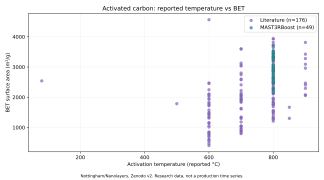
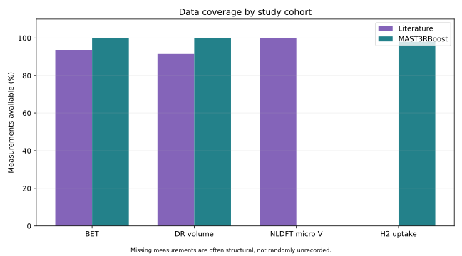

# 활성탄 제조조건·물성 데이터: 기초 분석 결과

자료: University of Nottingham / Nanolayers, Zenodo v2, DOI 10.5281/zenodo.23311682.
원본 데이터 이용조건: CC BY-ND 2.5. 이 저장소는 원본 CSV를 재배포하지 않습니다.

## 시료·측정 범위 확인

- 관측 단위: 활성탄 시료 237개 (서로 다른 양산 Batch가 아님).
- 원본 변수 34개, 고유 시료 ID 237개.
- 문헌 시료 188개 / MAST3RBoost 프로젝트 시료 49개.
- 원본은 세미콜론 구분, 단위 행 포함, 마지막 빈 열 구분자 포함.
- BET 열 원문 오타를 유지해 처리: [ouptut] ABET.

| 구분 | 시료 수 | BET 관측 | BET 결측 | BET 평균(m²/g) |
|---|---:|---:|---:|---:|
| 문헌 시료 | 188 | 176 | 12 | 2084.32 |
| 연구 프로젝트 | 49 | 49 | 0 | 2942.07 |

## 그림

## 제조 엔지니어 관점의 해석

1. 시료 출처에 따른 측정 항목의 차이를 먼저 점검해야 합니다.
2. 문헌 시료에는 수소 흡착량이 대부분 측정되지 않았습니다. 이를 0으로 대체하지 않습니다.
3. 서로 다른 실험계·원료·활성화 조건을 혼합한 평균 차이는 원인효과가 아닙니다.
4. 활성화 온도와 BET를 비교할 때 원료 조성, K/C, 유지시간, 분석법 등을 함께 검토해야 합니다.
5. 실제 Scale-up 판단을 하려면 원료 LOT, 설비 형상, 열이력, 분위기, 수율, 반복측정과 원단위 데이터가 추가로 필요합니다.

## 범위 및 한계

완료: 원본 무결성 검사, 시료 ID 검증, 단위 행·스키마 처리, 출처별 결측 확인, 기초 시각화.
미완료: 인과 분석, 양산 전환 검증, 최적 제조조건 도출, 경제성·에너지 원단위 평가.
